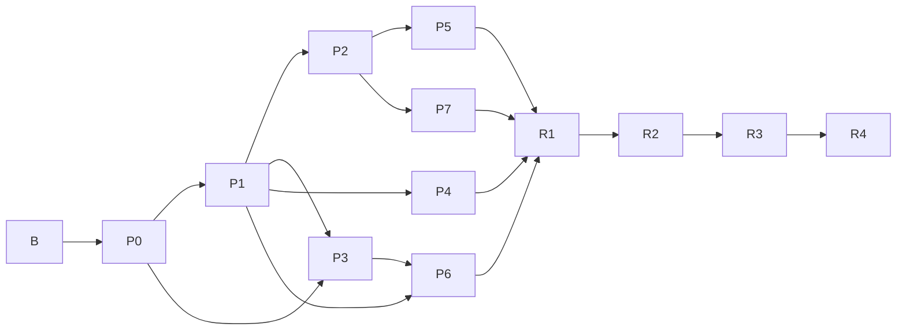

# Stage plans

Each stage proves one claim. Each has numbered tasks with acceptance criteria, research questions with **defaults** (so research never blocks progress), and a gate.

| Stage | Claim proven | Depends on | Est. (Claude-driven) | File |
|---|---|---|---|---|
| **B** | The project can build, test and touch hardware without a human in the loop | — | 1–2 weeks (+ shipping time for hardware) | `B-bootstrap.md` |
| **P0** | A precise, validated spec exists and error messages make sense | B.T1–T4 | 2 weeks | `P0-spec.md` |
| **P1** | A description alone can drive a device (Linux) | P0 | 2–3 weeks | `P1-linux-runtime.md` |
| **P2** | One description works on every OS, and failures name their layer | P1 | 3–4 weeks | `P2-cross-os.md` |
| **P3** | AI writes the description from a datasheet | P0 (P1 for HIL check) | 3–4 weeks | `P3-ai-drafter.md` |
| **P4** | Private, signed, automatic: plug in and it works | P1 | 3–4 weeks | `P4-registry-agent.md` |
| **P5** | Unmodified apps see the device as a native OS device | P2 | 2–3 weeks | `P5-native-surfaces.md` |
| **P6** | Works without the vendor: traffic → working driver | P3, P1 | 3–4 weeks | `P6-trace.md` |
| **P7** | Vendor logic is private-ish, portable and contained | P2 | 3 weeks | `P7-logic-sandbox.md` |
| **R1** | Alpha with design partners + hosted cloud alpha | P0–P7 gates | months 7–13 | `R1-alpha.md` |
| **R2** | Public beta, billing, PCI, distro packaging, spec 1.0 | R1 | months 13–20 | `R2-beta.md` |
| **R3** | 1.0, kernel driver generation, foundation | R2 | months 20–36 | `R3-v1.md` |
| **R4** | Platform: complex classes, on-device descriptions | R3 | years 3–5 | `R4-platform.md` |



Parallelism: after P1, the order P2 → P3 → P4 → P5 → P6 → P7 is the default, but when one stage is blocked on hardware or a human action, work on any other stage whose dependencies are met.

## Stage file format

```
# <ID> — <claim>
Status · Depends on · Branch
## Exit criteria (the gate)          ← numbered, each with a check command / evidence
## Pre-made decisions                ← already settled; don't reopen
## Research questions                ← R-<ID>-n: question · needed by · default if unresolved · Status
## Tasks                             ← - [ ] <ID>.Tn title (deps) + Do / Accept
## Risks and debugging hints
## Human actions                     ← H-xxx ids, defined in progress/HUMAN-ACTIONS.md
## Gate procedure                    ← usually: run /gate
```

## Plan maintenance

- Stages R1–R4 are deliberately coarser. **The first task of every stage is "Expand this plan"**: re-read the north star, the previous gate report and research notes, then rewrite the stage's tasks to the same detail as P1 before building.
- You may add, split or reorder tasks at any time. Record why in the commit message. You may not delete an exit criterion without an ADR.
